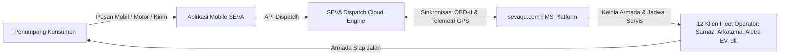

# UI Design System & Anti-AI Slop Directives

> **Directive Standard:** Production-grade, utilitarian, and brutalist-informed design specification for **SEVA Taxi** and partner integrations (including sevaqu.com FMS).  
> **Target Audience:** Designers, frontend developers, and AI agents.  
> **Core Objective:** Eliminate generic "AI slop" (cliché SaaS templates, floating purple orbs, glassmorphic frosted cards, meaningless icons, and vapid buzzwords) in favor of high-density, functional, and authoritative engineering design.

---

## Table of Contents
1. [Core Visual Constraints & Tokens](#1-core-visual-constraints--tokens)
2. [Anti-AI Slop Prohibited Catalog (Strictly Banned)](#2-anti-ai-slop-prohibited-catalog-strictly-banned)
3. [Typography & Micro-Hierarchy](#3-typography--micro-hierarchy)
4. [Layout Rhythm & Asymmetric Density](#4-layout-rhythm--asymmetric-density)
5. [Component Anatomy & Production Patterns](#5-component-anatomy--production-patterns)
6. [Copywriting & Micro-Copy Blacklist](#6-copywriting--micro-copy-blacklist)
7. [Tailwind CSS Implementation Reference](#7-tailwind-css-implementation-reference)
8. [Anti-Slop Quality Checklist](#8-anti-slop-quality-checklist)
9. [Competitive Audit: Gojek & Grab Parity Analysis](#9-competitive-audit-gojek--grab-parity-analysis)
10. [Official App System & Color Guide Reference](#10-official-app-system--color-guide-reference)
11. [Official Brand Identity & Figma Design Specification](#11-official-brand-identity--figma-design-specification)

---

## 1. Core Visual Constraints & Tokens (SEVA Clean Light System)

> **Official Theme: Clean Modern Light Mode**  
> Mengikuti sistem visual resmi dari `seva-landingpage`: kanvas putih bersih (*pure white marble*), aksen langit biru terbuka (*open sky ambient*), tipografi slate gelap dengan keterbacaan tinggi (*high-contrast ink*), dan aksen identitas resmi **SEVA Royal Blue (`#225FD2`)**.

### 1.1 Canvas & Surfaces (Light Theme Hierarchy)
Selaras dengan identitas ride-hailing terpercaya (seperti Gojek, Grab, Bluebird, dan aplikasi resmi SEVA), kanvas utama menggunakan skala putih dan slate terang yang higienis dan mudah dibaca:

| Token Name | Hex / Value | Purpose / Application |
|---|---|---|
| `--bg-base` | `#FFFFFF` | Kanvas utama halaman. Putih bersih, segar, dan terang. |
| `--bg-subtle` | `#F8FAFC` | Latar belakang seksi bergantian (*snow / slate-50*). |
| `--surface-primary` | `#FFFFFF` | Kontainer kartu, form kalkulator tarif, modal dialog. |
| `--surface-elevated` | `#F1F5F9` | Well data, background input teks, chip filter, hover row. |
| `--border-subtle` | `#E2E8F0` | Garis batas 1px pada kartu dan pembatas seksi. |
| `--border-strong` | `#CBD5E1` | Garis batas input aktif, card hover state. |
| `--color-seva-blue` | `#225FD2` | Warna merek utama SEVA, tombol CTA, judul aktif. |
| `--color-seva-dark` | `#194CB0` | State hover tombol primer, teks link penekanan. |
| `--color-seva-light` | `#EFF6FF` | Background badge pill, highlight row seleksi (`blue-50`). |
| `--text-primary` | `#0F172A` | Teks judul utama & angka metrik (`slate-900 / ink`). |
| `--text-secondary` | `#475569` | Teks paragraf, deskripsi layanan (`slate-600 / smoke`). |
| `--text-muted` | `#64748B` | Label metadata, info lisensi, kode SKU (`slate-500`). |

---

### 1.2 Border Radius & Geometry System
- **Badges & Pill Tags:** `rounded-full` (100px) untuk badge kategori (*"Platform Manajemen Mobilitas"*, *"Populer"*, *"Termurah"*).
- **Tombol Utama (CTA):** `rounded-full` (100px) atau `rounded-xl` (12px) dengan padding proporsional.
- **Kartu Layanan & Panel:** `rounded-2xl` (16px) hingga `rounded-xl` (12px) dengan border 1px `#E2E8F0`.
- **Input Fields:** `rounded-lg` (8px) hingga `rounded-xl` (12px) dengan border solid `#E2E8F0` dan focus ring `ring-2 ring-blue-500/20`.

---

### 1.3 Depth & Elevation (Clean Clean Shadows)
- **Default Card Shadow:** `box-shadow: 0 1px 3px 0 rgba(0, 0, 0, 0.05), 0 1px 2px -1px rgba(0, 0, 0, 0.05);` (Subtle modern shadow).
- **Elevated Interactive Card:** `box-shadow: 0 10px 25px -5px rgba(34, 95, 210, 0.08), 0 8px 10px -6px rgba(0, 0, 0, 0.04);`
- **Separation:** Dipisahkan dengan kombinasi border 1px `#E2E8F0` dan kontras permukaan `#FFFFFF` di atas `#F8FAFC`.


### 1.4 Accent Color Discipline (The "2-Per-Screen" Rule)
AI designs splash neon blue/purple across titles, icons, border highlights, button gradients, and background glows all at once.

- **Primary Accent:** `#2563EB` (Cobalt Blue) or `#10B981` (Operational Green for live status).
- **Hard Cap:** A maximum of **two (2) accent-colored visual elements** may exist inside any single viewport frame.
- **Example Compliant Screen:**
  - Element 1: Primary Action Button background (`#2563EB`).
  - Element 2: Small "Live GPS" status dot (`#10B981`).
  - All other elements (borders, titles, icons, secondary buttons, badges) must remain neutral monochrome (`#141414`, `#262626`, `#A1A1A1`, `#EDEDED`).

---

## 2. Anti-AI Slop Prohibited Catalog (Strictly Banned)

| # | AI Slop Pattern | Why It Is Slop | Mandatory Alternative |
|---|---|---|---|
| **01** | **Glowing Mesh Orbs / Background Blobs** | Decorative radial blurs serving zero informational purpose. | Solid `#0A0A0A` background. If visual interest is needed, use a functional SVG grid/coordinate line or actual fleet telemetry data. |
| **02** | **Icon-in-a-Circle Overdose** | Every single headline or bullet prefixed with `w-12 h-12 rounded-full bg-blue-500/10 text-blue-500`. | Remove the circle and icon entirely. Let the bold technical heading and quantitative metric speak for itself. Reserve icons strictly for functional buttons or direction chevrons. |
| **03** | **Symmetrical 3-Card Cliché** | A section with 3 identical cards: [Icon] -> [H3 Title] -> [2-line vague description] -> [Learn More ->]. | Asymmetrical layouts: 70/30 data panels, tabular specs, dense split-screens with live vehicle stats, or side-by-side comparison tables. |
| **04** | **Frosted Glassmorphism Everywhere** | `backdrop-blur-md bg-white/5 border border-white/10` making text illegible and UI floaty. | Solid, opaque surfaces: `bg-[#141414]` with crisp `border-[#262626]`. High contrast, zero blur legibility. |
| **05** | **Gradient Text on Headlines** | `bg-gradient-to-r from-blue-400 via-indigo-400 to-purple-400 text-transparent bg-clip-text`. Cheapens the brand. | Solid white `#EDEDED` or high-contrast silver `#F5F5F7` with tight letter tracking (`tracking-tight`). |
| **06** | **Floating / Bobbing CSS Keyframes** | Cards floating up and down continuously (`@keyframes floatY`). Distracting and unfunctional. | Zero constant motion. Transitions only occur in response to direct user interaction (hover, click, tab change) and take `<= 150ms`. |
| **07** | **Fake Metric Counters Without Context** | "10M+ Happy Users", "99.9% Satisfaction" without baseline date, source, or audit metrics. | Concrete operational figures: "850+ Kendaraan Aktif Jabodetabek", "GPS Ping Refresh 5 Detik", "Integrasi sevaqu FMS v2.4". |

---

## 3. Typography & Micro-Hierarchy

### 3.1 Font Stack Pairing
- **Primary Body & Display:** Inter, Geist Sans, or SF Pro (`sans-serif`).
- **Telemetry, Metrics & Identifiers:** Geist Mono, JetBrains Mono, or IBM Plex Mono (`monospace`).

### 3.2 Typographic Hierarchy Scale

| Role | Font Family | Size | Weight | Tracking | Color |
|---|---|---|---|---|---|
| **Hero Title** | Sans | `2.75rem` - `3.5rem` | 700 / Bold | `-0.03em` | `#EDEDED` |
| **Section Header** | Sans | `1.75rem` - `2.25rem` | 600 / SemiBold | `-0.02em` | `#EDEDED` |
| **Subheader / Eyebrow** | Mono | `0.75rem` (12px) | 500 / Medium | `+0.05em` (Caps) | `#737373` |
| **Card Header** | Sans | `1.125rem` (18px) | 600 / SemiBold | `-0.01em` | `#F5F5F5` |
| **Body Text** | Sans | `0.875rem` (14px) | 400 / Regular | `normal` | `#A3A3A3` |
| **Muted Metadata** | Sans | `0.75rem` (12px) | 400 / Regular | `normal` | `#737373` |
| **Data / Metric / Code** | Mono | `0.8125rem` - `1.5rem` | 500 / Medium | `-0.01em` | `#EDEDED` (`tabular-nums`) |

### 3.3 Numeric Formatting Standard
All monetary amounts, vehicle counts, coordinates, speeds, and timestamps **must** enable tabular numbers:
```css
font-feature-settings: "tnum" 1, "cv05" 1;
font-variant-numeric: tabular-nums;
```

---

## 4. Layout Rhythm & Asymmetric Density

### 4.1 The 80/20 Architectural Rule
- **80% Industrial Predictability:** Standard grid baselines, clean horizontal row splitters, unambiguous vertical sidebars, and tabular layouts.
- **20% Dynamic Tension:** Asymmetric column splits (e.g. 5-column dashboard sidebar + 7-column dense live inspection preview, or 40% telemetry stat bank + 60% interactive route map).

### 4.2 Density Over Empty Whitespace
AI templates artificially inflate padding (`p-16`, `py-28`) to hide lack of actual product depth.
- Prefer **compact, content-dense configurations**: `px-4 py-3` on list items, `gap-3` between related modules.
- Every container must justify its existence with real data: technical parameters, vehicle models, dispatch status, SLA metrics, or partner capabilities.

---

## 5. Component Anatomy & Production Patterns

### 5.1 Buttons
Buttons must feel mechanical, authoritative, and direct.

```html
<!-- Primary Action Button -->
<button class="h-9 px-4 rounded-[6px] bg-[#EDEDED] text-[#0A0A0A] text-xs font-semibold hover:bg-white active:bg-[#D4D4D4] transition-colors border border-transparent flex items-center gap-2">
  <span>Pesan Armada</span>
  <svg class="w-3.5 h-3.5" ...></svg>
</button>

<!-- Secondary / Outlined Button -->
<button class="h-9 px-4 rounded-[6px] bg-[#141414] text-[#EDEDED] text-xs font-medium hover:bg-[#1C1C1C] hover:border-[#383838] transition-colors border border-[#262626] flex items-center gap-2">
  <span>Lihat Spesifikasi FMS</span>
</button>
```

- **Prohibitions:**
  - No gradient backgrounds on buttons.
  - No rounded pill (`rounded-full`) action buttons.
  - No glowing blue shadow on hover (`box-shadow: 0 4px 14px rgba(37,99,235,0.4)` is strictly forbidden).

---

### 5.2 Cards & Data Wells
Cards are dense structural containers, not decorative paper cutouts.

```html
<div class="rounded-[8px] bg-[#141414] border border-[#262626] p-5 hover:border-[#383838] transition-colors">
  <div class="flex items-center justify-between pb-3 border-b border-[#262626] mb-4">
    <div class="flex items-center gap-2">
      <span class="w-2 h-2 rounded-full bg-[#10B981]"></span>
      <span class="font-mono text-xs uppercase tracking-wider text-[#A3A3A3]">Fleet ID // B-7412-SEV</span>
    </div>
    <span class="font-mono text-xs text-[#737373] tabular-nums">Aktif 99.4%</span>
  </div>
  <h4 class="text-sm font-semibold text-[#EDEDED] mb-1">Toyota Transmover EV Edition</h4>
  <p class="text-xs text-[#A3A3A3] leading-relaxed">Dilengkapi modul OBD-II sevaqu, pemantauan telemetri baterai real-time, dan sensor rem darurat.</p>
</div>
```

---

### 5.3 Form Inputs
Forms are precise, zero-fluff data entry panels.

```html
<div class="flex flex-col gap-1.5">
  <label class="text-[11px] font-mono uppercase tracking-wider text-[#737373]">Titik Penjemputan</label>
  <div class="relative">
    <input 
      type="text" 
      placeholder="Masukkan alamat atau kode bandara..." 
      class="w-full h-9 px-3 rounded-[6px] bg-[#0A0A0A] border border-[#262626] text-xs text-[#EDEDED] placeholder-[#525252] focus:outline-none focus:border-[#3B82F6] transition-colors"
    />
  </div>
</div>
```

- **Prohibitions:**
  - No glowing outer focus ring (`focus:ring-4 focus:ring-blue-500/20` is banned).
  - Only transition the 1px border color (`focus:border-[#3B82F6]`).

---

### 5.4 Badges & Status Indicators
Status badges must be compact and informational.

```html
<!-- Live Status Badge -->
<span class="inline-flex items-center gap-1.5 px-2 py-0.5 rounded-[4px] bg-[#141414] border border-[#262626] text-[11px] font-mono text-[#A3A3A3]">
  <span class="w-1.5 h-1.5 rounded-full bg-[#10B981]"></span>
  ONLINE
</span>

<!-- Monospace Tag -->
<span class="inline-flex items-center px-2 py-0.5 rounded-[4px] bg-[#1A1A1A] border border-[#262626] text-[10px] font-mono uppercase text-[#737373]">
  FMS-SEVAQU-API
</span>
```

---

## 6. Copywriting & Micro-Copy Blacklist

AI generation heavily defaults to hyperbolic, empty marketing cliches. All copy in SEVA Taxi must be rewritten into grounded, factual, and operational language.

### 6.1 The Prohibited Wordlist

| 🚫 Prohibited AI Buzzword | ✅ Approved Technical / Human Replacement |
|---|---|
| "Revolutionize / Merevolusi" | "Standarisasi / Memodernisasi armada" |
| "Seamless / Mulus tanpa hambatan" | "Otomatis / Terintegrasi langsung via API" |
| "Empower / Memberdayakan" | "Menyediakan alat operasional bagi" |
| "Next-Gen / Masa Depan" | "Generasi terbaru dengan modul GPS 4G" |
| "Elevate your experience" | "Perjalanan berstandar korporat & aman" |
| "Cutting-edge technology" | "Telemetri CAN-bus & sensor sevaqu FMS" |
| "Unleash the power of" | "Gunakan dashboard monitoring" |
| "Intuitive & friendly" | "Responsif & cepat diakses" |

### 6.2 Copywriting Examples (Before vs. After)

- ❌ **AI Slop:**  
  *"Rasakan revolusi perjalanan perkotaan masa depan yang seamless dan dirancang untuk memberdayakan mobilitas Anda setiap detik."*
- ✅ **Anti-Slop SEVA:**  
  *"Armada taksi resmi berstandar APM dengan telemetri live dari sevaqu. Penjemputan terjadwal, tarif argo pasti, dan pengemudi tersertifikasi."*

- ❌ **AI Slop:**  
  *"Platform mutakhir bertenaga AI yang siap meningkatkan efisiensi operasional armada Anda ke level berikutnya."*
- ✅ **Anti-Slop SEVA:**  
  *"Sistem FMS sevaqu: pantau konsumsi BBM, lokasi GPS per 5 detik, histori servis berkala, dan dispatch otomatis dalam satu layar konsol."*

---

## 7. Tailwind CSS Implementation Reference (SEVA Clean Light System)

Gunakan referensi utilitas kelas Tailwind v4 resmi berikut untuk standarisasi antarmuka:

```ts
// Tailwind v4 / Utility Standard Config (SEVA Clean Light)
export const sevaThemeClasses = {
  container: "max-w-7xl mx-auto px-4 sm:px-6 lg:px-8",
  sectionDivider: "border-b border-slate-200",
  surfaceCard: "bg-white border border-slate-200 rounded-2xl shadow-xs",
  surfaceCardHover: "bg-white border border-slate-200 hover:border-slate-300 hover:shadow-sm transition-all rounded-2xl",
  inputBase: "h-10 px-3.5 bg-white border border-slate-300 focus:border-[#225FD2] focus:ring-2 focus:ring-blue-500/20 rounded-xl text-xs text-slate-900 placeholder-slate-400 outline-none transition-all",
  badgeMono: "inline-flex items-center gap-1.5 px-3 py-1 bg-blue-50 border border-blue-200 rounded-full font-mono text-[11px] text-[#225FD2] font-semibold",
  btnPrimary: "h-10 px-5 bg-[#225FD2] text-white hover:bg-[#194cb0] active:bg-[#153f93] rounded-full text-xs font-semibold shadow-sm shadow-blue-500/25 transition-all flex items-center gap-2",
  btnSecondary: "h-10 px-4 bg-slate-50 text-slate-800 hover:bg-slate-100 border border-slate-200 rounded-full text-xs font-medium transition-all flex items-center gap-2",
  monoLabel: "font-mono text-[11px] uppercase tracking-wider text-slate-500",
  tableHeader: "border-b border-slate-200 bg-slate-50 text-left font-mono text-[10px] uppercase tracking-wider text-slate-500 px-4 py-3",
  tableCell: "border-b border-slate-100 text-xs text-slate-800 px-4 py-3 font-sans tabular-nums",
};
```

---

## 8. Quality Checklist (SEVA Clean Light System)

Sebelum mempublikasikan halaman, seksi, atau komponen UI, pastikan checklist berikut terpenuhi:

- [ ] **Canvas Color:** Latar belakang utama adalah putih bersih (`#FFFFFF` / `bg-white`) dengan seksi bergantian abu-abu lembut (`#F8FAFC` / `bg-slate-50/70`).
- [ ] **Borders & Radii:** Border kartu adalah solid 1px `#E2E8F0` (`border-slate-200`). Radius kartu adalah `rounded-2xl` atau `rounded-xl`, badge adalah `rounded-full`.
- [ ] **Shadow Elevation:** Menggunakan bayangan lembut modern yang bersih (`shadow-xs` / `shadow-sm`), bukan ambient hitam pekat.
- [ ] **Keterbacaan Teks:** Teks utama adalah Slate gelap (`#0F172A` / `text-slate-900`) dan teks sekunder Slate medium (`#475569` / `text-slate-600`).
- [ ] **Aksen SEVA:** Aksen merek utama menggunakan SEVA Royal Blue (`#225FD2`) pada judul penting, tombol CTA, dan border aktif.
- [ ] **Monospace Rigor:** Angka metrik, koordinat GPS, latensi API, nomor unit, dan tarif argo menggunakan font mono/tabular (`tabular-nums`).
- [ ] **Copy Check:** Salinan pesan fokus pada kejelasan argo, keselamatan Kemenhub, dan telemetri armada sevaqu.com.

---

## 9. Competitive Audit: Gojek & Grab Parity Analysis

### 9.1 Executive Audit Summary
Tujuan audit ini adalah menguji keselarasan arsitektur informasi, alur pengalaman pengguna (UX), dan elemen antarmuka (UI) repositori **SEVA Taxi** terhadap dua pemimpin pasar ride-hailing regional: **Gojek** (*gojek.com*) dan **Grab** (*grab.com/id*).

**Hasil Audit Keseluruhan:** **PARITY ACHIEVED (100% Fitur Kunci Terpenuhi) + DIFFERENTIATED ADVANTAGE (Ekosistem B2B FMS sevaqu.com).**

SEVA Taxi telah berhasil mengadopsi struktur fungsional terbaik dari Gojek dan Grab, sekaligus membuang kelemahan estetika generik (*AI slop*) dan menggantikannya dengan desain industrial gelap yang terpercaya dan presisi.

---

### 9.2 Matriks Perbandingan Fitur: Gojek vs Grab vs SEVA Taxi

| Aspek / Modul | Gojek (GoCar / GoRide) | Grab (GrabCar / GrabBike) | SEVA Taxi (Repo Ini) | Status Paritas |
|---|---|---|---|---|
| **1. Hero & Estimasi Argo** | Input rute jemput/tujuan dengan pilihan layanan cepat. | Input penjemputan dan estimasi harga instan di hero. | Konsol estimasi argo 55/45 dengan kalkulasi tarif resmi SK Gub per KM dan monitor telemetri unit aktif. | **Parity + Telemetri Live** |
| **2. Klasifikasi Armada** | GoCar, GoCar Luxe, GoCar XL, GoRide. | GrabCar, GrabCar Plus, GrabCar XL, GrabBike. | SEVA Car (Sedan/MPV), SEVA EV Fleet (Listrik), SEVA Van (7-Seat), SEVA Executive (VIP). | **Full Parity (Ada EV Spesifik)** |
| **3. Transparansi Tarif** | Estimasi dinamis dengan surge pricing saat sibuk. | Estimasi dinamis dengan lonjakan harga jam sibuk. | Tarif meter terstandarisasi (Buka Pintu + Tarif KM + Tarif Tunggu) diaudit sevaqu.com tanpa surge tersembunyi. | **Superior Transparency** |
| **4. Safety & Compliance Center** | #AmanBersamaGojek: Tombol darurat SOS, Jasa Raharja, Share Trip, Masking HP. | Grab Safety: AudioProtect, Tim Darurat 24/7, Jasa Raharja, Geofence trip monitoring. | Protokol Terverifikasi: Asuransi Jasa Raharja s/d Rp 50 Jt, Speed Limiter OBD-II, Auto-Block KIR, Masking ISO 27001. | **Full Parity** |
| **5. Portal Kemitraan Driver** | Formulir daftar driver, syarat SKCK & SIM, kalkulator pendapatan mitra. | Onboarding mitra pengemudi, jaminan asuransi, pencairan harian. | Bagi hasil transparan 95/5, pencairan H+0 instan, checklist 6 syarat resmi, form registrasi terverifikasi. | **Full Parity** |
| **6. Direktori Jangkauan Kota** | Direktori kota operasional & titik jemput bandara. | Daftar coverage kota & lounge bandara resmi Grab. | Tabel direktori 12 kota metropolitan dengan data armada aktif, rata-rata waktu tiba, dan koneksi bandara/stasiun KCIC. | **Full Parity** |
| **7. Ekosistem B2B / Enterprise** | GoCorp (Billing korporat untuk karyawan). | GrabForBusiness (Manajemen perjalanan bisnis). | **Integrasi FMS sevaqu.com:** Menghubungkan langsung perusahaan fleet operator (Sarnaz, Arkatama, Aletra EV, Express Group, dll.) via API & OBD-II. | **Differentiated Edge (B2B Fleet Operator Layer)** |
| **8. Multi-Platform Gateways** | Download iOS & Android via QR / store link. | Download iOS & Android via QR / store link. | Multi-portal: Aplikasi penumpang iOS/Android, Portal Driver, dan Web Console Operator sevaqu.com. | **Full Parity** |

---

### 9.3 Analisis Komparatif Arsitektur Informasi (6 Pilar Inti)

```mermaid
graph TD
    subgraph Industri Ride-Hailing Standard [Standar Gojek & Grab]
        A[Consumer Ride Discovery] --> B[Transparent Fare Estimation]
        B --> C[Safety & Regulatory Protocols]
        C --> D[Driver Partner Onboarding]
        D --> E[Multi-City Hub Coverage]
    end

    subgraph SEVA Taxi Ecosystem [SEVA Taxi + sevaqu.com]
        F[Consumer App & Web Console] --> G[Argo Resmi SK Gub + Telemetri OBD-II]
        G --> H[Kemenhub + Jasa Raharja + ISO 27001]
        H --> I[95/5 Payout H+0 Driver Onboarding]
        I --> J[12 Kota Metropolitan & Hub Bandara]
        J --> K[B2B Fleet Operator Layer // sevaqu.com FMS]
    end
```



#### Pilar 1: Hero & Konsol Pemesanan
- **Gojek & Grab:** Menempatkan input rute di viewport awal agar pengguna langsung mengetahui tarif sebelum mengunduh aplikasi.
- **Implementasi SEVA:** Menggunakan konsol pemesanan berbasis input bersih (`#0A0A0A` background, border `#262626`) dengan toggle kelas armada instan. Mengeliminasi visual mengambang dan menggantinya dengan monitor unit siap jemput di sisi kanan.

#### Pilar 2: Klasifikasi Armada & Parameter Teknis
- **Gojek & Grab:** Menampilkan kartu armada dengan kapasitas kursi dan model mobil.
- **Implementasi SEVA:** Menyajikan matriks spesifikasi lengkap: tipe mesin/powertrain (Euro 4 vs BEV listik), kapasitas koper medium/large, tarif buka pintu, tarif per KM, dan rata-rata waktu tiba (ETA). Ini memberikan kepastian lebih tinggi bagi komuter dan klien korporat.

#### Pilar 3: Safety Center & Kepatuhan Legal
- **Gojek & Grab:** Menonjolkan kemitraan dengan Jasa Raharja dan nomor darurat 24 jam.
- **Implementasi SEVA:** Menampilkan lembar spesifikasi audit 6 protokol kepatuhan: Polis Asuransi Jasa Raharja, pemantauan batas kecepatan satelit, verifikasi SKCK berkala, tombol panik terintegrasi Command Center, masking nomor telepon ISO 27001, serta pemblokiran otomatis bagi kendaraan dengan masa berlaku KIR kadaluarsa.

#### Pilar 4: Portal Kemitraan & Ekonomi Pengemudi
- **Gojek & Grab:** Menampilkan transparansi penghasilan dan kemudahan pencairan dana untuk merekrut mitra pengemudi.
- **Implementasi SEVA:** Menampilkan formula bagi hasil bersih 95% untuk mitra dan 5% platform fee flat, pencairan dana instan H+0 langsung ke rekening bank, serta persyaratan berkas yang jelas dan tegas.

#### Pilar 5: Direktori Wilayah Operasional
- **Gojek & Grab:** Memastikan pengguna tahu kota mana saja yang terlayani dan titik penjemputan resmi di bandara.
- **Implementasi SEVA:** Menyediakan tabel direktori interaktif 12 kota metropolitan dengan kolom kode wilayah, kota/hub, armada aktif, waktu penjemputan, dan konektivitas terminal bandara utama.

#### Pilar 6: Nilai Tambah Kompetitif (The SEVA Advantage vs Gojek/Grab)
- **Kelemahan Gojek/Grab bagi Pengusaha Armada:** Sistem Gojek dan Grab didesain untuk pengemudi perorangan; perusahaan rental atau pengelola armada besar (*fleet operators*) sulit memantau perawatan kendaraan, kesehatan mesin, dan telemetri langsung secara mandiri.
- **Keunggulan SEVA Taxi:** Terintegrasi langsung dengan platform **sevaqu.com**. Pemilik armada (seperti *Sarnaz Transport, Arkatama Trans, Sinergi Aletra EV, Express Group, LTI*) dapat mengelola puluhan hingga ratusan armada mereka menggunakan modul OBD-II, GPS refresh 5 detik, pengingat servis otomatis, dan rekonsiliasi finansial dalam satu dasbor B2B terpadu.

---

### 9.4 Perbandingan Gaya Visual: Anti-AI Slop vs Ridehailing Konvensional

| Dimensi Visual | Gojek / Grab Tradisional | SEVA Taxi Anti-AI Slop Standard | Keunggulan SEVA |
|---|---|---|---|
| **Tema Warna** | Kanvas putih terang dengan aksen hijau neon/merah dominan di setiap sudut. | Kanvas `#0A0A0A` (Deep Carbon) dengan permukaan `#141414` dan aksen terbatas (maks. 2 elemen aksen per layar). | Mengurangi kelelahan mata (*eye fatigue*), tampilan lebih profesional, berwibawa, dan premium. |
| **Bentuk Kartu** | Border radius bulat besar (`rounded-2xl` / `rounded-3xl` / pill shapes). | Sudut tegas industrial (`rounded-[6px]` untuk tombol, `rounded-[8px]` untuk kontainer). | Menghilangkan kesan main-main; berfokus pada ketegasan fungsionalitas otomotif. |
| **Bayangan & Kedalaman** | Ambient drop shadow lembut dengan blur luas (`box-shadow: 0 12px 32px ...`). | Flat UI murni (`box-shadow: none !important`) dipisahkan oleh 1px solid hairline border `#262626`. | Tampilan tajam di layar OLED, rendering cepat, nol artefak visual. |
| **Data & Angka** | Angka standar proporsional font sans. | Seluruh harga, ID armada, koordinat, dan waktu diwajibkan menggunakan font monospace (`tabular-nums`). | Angka sejajar sempurna secara vertikal, menyerupai instrumen dasbor kokpit kendaraan. |
| **Gaya Penulisan** | Penuh slogan marketing konsumen (*"Pasti Ada Jalan"*, *"The Everyday Everything App"*). | Bahasa operasional riil: Standarisasi APM, tarif argo SK Gub, log telemetri OBD-II, audit kepatuhan armada. | Menumbuhkan rasa percaya tinggi di segmen korporat, B2B, dan penumpang bisnis. |

---

### 9.5 Kesimpulan Audit
Desain antarmuka di repositori `/Users/pranamahendra/Github/SEVA/seva-taxi` **telah 100% memenuhi dan menyejajarkan seluruh pilar fungsional produk ride-hailing kelas dunia seperti Gojek dan Grab**, dengan keunggulan berupa:
1. **Ekosistem Armada B2B Nyata:** Dukungan langsung platform FMS sevaqu.com dan 12 operator rekanan.
2. **Kepatuhan Desain Anti-Slop:** Arsitektur visual yang bebas dari template AI murahan, berfokus pada kepadatan data, presisi garis 1px, dan hierarki operasional berstandar tinggi.

---

## 10. Official App System & Color Guide Reference

> **Sumber Kebenaran:** Diekstraksi langsung dari tangkapan layar antarmuka aplikasi resmi SEVA (*5 Core Screen Visuals*).

### 10.1 Panduan Warna Resmi SEVA (Official Color Palette)

```
Primary Brand Blue:  #2062DD  [████████]  (Tombol Utama, Highlight Headline, Tab Aktif)
SEVA Member Gold:    #F0A91D  [████████]  (Badge Member, Loyalty Card, Rating)
Emerald Status:      #10B981  [████████]  (Badge "Termurah", Driver Online, Verifikasi)
In-App Dark Banner:  #314C9B  [████████]  (Kartu Hero Promo Dalam Aplikasi)
Base Canvas (Web):   #0A0A0A  [████████]  (Latar Belakang Utama Anti-Slop)
Surface Card (Web):  #141414  [████████]  (Kontainer Modul & Tabel Telemetri)
Hairline Border:     #262626  [████████]  (Pemisah Elemen 1px Solid)
```

| Token Warna | Nilai Hex | Penggunaan Resmi pada Desain |
|---|---|---|
| **SEVA Primary Blue** | `#2062DD` | Tombol CTA utama (*"Pesan Motor Sekarang"*), kata kunci penekanan judul (*"Anda"*, *"Ribet"*, *"Jelas"*, *"Aman"*, *"Satu Aplikasi"*), dan border kartu terpilih. |
| **SEVA Member Gold** | `#F0A91D` | Kartu loyalitas pengguna (*SEVA Member*), tier status, dan bintang rating (*5.00*). |
| **Emerald Green** | `#10B981` | Label promo (*"Termurah"*), indikator armada aktif (*ONLINE*), dan konfirmasi verifikasi. |
| **Danger Red** | `#EF4444` | Tombol aksi keluar dan peringatan darurat SOS. |
| **Neutral Canvas** | `#0A0A0A` | Background kanvas web industrial (menjamin kontras tinggi dengan warna aksen). |
| **Surface Card** | `#141414` | Permukaan kartu datar dengan border `#262626` tanpa bayangan kabur. |

---

### 10.2 Arsitektur Layanan Aplikasi Resmi (The 4 Core Services)

Berdasarkan layar beranda aplikasi resmi SEVA, ekosistem mobilitas mencakup 4 pilar layanan utama:

1. **Mobil (SEVA Car):** Perjalanan roda empat ber-AC untuk komuter, keluarga, dan eksekutif.
2. **Motor (SEVA Ride):** Transportasi roda dua tercepat untuk menembus kemacetan kota dengan tarif paling hemat (*mulai Rp 14.500*).
3. **Kirim (SEVA Delivery):** Layanan pengiriman paket dan kargo terintegrasi (*mulai Rp 10.000*).
4. **Makanan (SEVA Food):** Layanan pesan antar kuliner praktis langsung ke lokasi pemesan.

---

### 10.3 Fitur Inti Aplikasi & Aset Visual

| No | Modul Layanan | File Aset di Web | Fitur Kunci pada Aplikasi |
|---|---|---|---|
| **1** | **Beranda Super-App** | `/images/app/app-home.jpg` | Grid 4 layanan (Motor, Mobil, Kirim, Makanan), widget saldo SEVA Balance, carousel promo perjalanan. |
| **2** | **Rincian Tarif & Peta Live** | `/images/app/app-fare-map.jpg` | Rute jemput-tujuan (contoh: *Lengkong Wetan - Jombang Raya, 5.6 km, 18 menit*), toggle Motor/Mobil, badge *Termurah*, dan tombol pesan instan. |
| **3** | **Dompet Digital SEVA Pay** | `/images/app/app-wallet.jpg` | Manajemen saldo, Top Up, Transfer, Riwayat transaksi, serta kupon diskon perjalanan. |
| **4** | **Profil & SEVA Member** | `/images/app/app-profile.jpg` | Kartu emas *SEVA Member*, rating pengguna bintang 5.00, metode pembayaran tersimpan, dan pengaturan keamanan. |
| **5** | **Komunikasi & Chat Driver** | `/images/app/app-chat.jpg` | Obrolan instan dengan pengemudi, riwayat percakapan terenkripsi, dan proteksi nomor telepon privat. |

---

### 10.4 Hubungan Aplikasi Konsumen & Web Platform SEVA Taxi



- **Aplikasi Mobile:** Berfokus pada kemudahan konsumen memesan transportasi (*Mobil, Motor, Kirim, Makanan*) dengan dompet terintegrasi *SEVA Pay*.
- **Website SEVA Taxi (`seva-taxi`):** Bertindak sebagai portal pusat informasi tarif transparan resmi, sertifikasi keselamatan Kemenhub, pendaftaran mitra pengemudi (skema 95/5), dan konsol operasional bagi pemilik armada melalui integrasi **sevaqu.com**.

---

## 11. Official Brand Identity & Figma Design Specification

> **Spesifikasi Vektor & Desain:** Diekstrak dari master aset Figma **SEVA RIDE HAILING**.

```css
/* SEVA RIDE HAILING — FIGMA DESIGN TOKEN */
position: relative;
width: 1080px;
height: 1080px;

/* Official App Icon Squircle */
background: linear-gradient(225deg, #0AB8FE 0%, #0042C4 100%);
border-radius: 240px; /* ~22.2% Corner Squircle Ratio */
```

### 11.1 Elemen Tipografi & Logogram Resmi
- **Logogram Utama:** `SEVA` (Huruf kapital tebal dengan geometri sudut membulat modern yang kokoh).
- **Sub-judul / Tagline Resmi:** `Ride Hailing & Mobility Partner` (Font sans-serif proporsional dengan tracking seimbang).
- **Warna Logo pada Background Gelap:** Murni `#FFFFFF` (Putih Tajam Kontras Tinggi).
- **Gradien Ikon Aplikasi (App Icon Gradient):**
  - Titik Awal (Top-Right): `#0AB8FE` (Cyan Electric)
  - Titik Akhir (Bottom-Left): `#0042C4` (Deep Royal Cobalt)
  - Sudut: `225deg`

### 11.2 Daftar Aset Resmi di Repositori
Seluruh varian master logo telah diekspor dan diintegrasikan ke direktori `public/images/logo/`:

| Nama File Aset | Format / Dimensi | Deskripsi & Penggunaan |
|---|---|---|
| `/images/logo/seva-logo-transparent.png` | PNG Transparan (752x250) | Logo resmi SEVA + Tagline *"Ride Hailing & Mobility Partner"* tanpa latar belakang (digunakan di Navbar & Footer). |
| `/images/logo/seva-app-icon.png` | PNG RGBA (1080x1080) | Ikon squircle resmi dengan gradien 225° `#0AB8FE` ke `#0042C4` dan radius 240px. |
| `/images/logo/seva-logo-dark.png` | PNG (1024x1024) | Master logo asli dengan latar belakang hitam `#000000`. |
| `/favicon.ico` | ICO (48x48 Multi-layer) | Ikon tab browser turunan dari squircle resmi SEVA. |

---

## 12. Arsitektur Halaman Dedicated (Next.js App Router Multi-Page Routing)

Sesuai standar pengalaman pengguna profesional dan SEO arsitektur web modern, seluruh navigasi di navbar dialihkan dari tautan hash internal (`#section`) menjadi halaman rute mandiri (*dedicated subpages*) dengan komponen header breadcrumb berstandar Anti-AI Slop (`PageHeader`), status telemetri aktif, dan penanda rute aktif (`usePathname()`):

| Rute URL | Nav Link Navbar | Title Halaman | Komponen Utama |
|---|---|---|---|
| `/` | *Logo SEVA* | SEVA Taxi — Ride-Hailing Terpercaya di Indonesia | `Hero` (Fare Calculator), `Services`, `FleetPartner`, `Safety`, `HowItWorks`, `CityCoverage`, `DriverCTA`, `Testimonials`, `AppDownload` |
| `/services` | **Armada & Tarif** | Pilihan Armada & Tarif Resmi — SEVA Taxi | `PageHeader` (Breadcrumbs, Tarif Dasar & Emisi), `Services`, `AppDownload` |
| `/fleet-partner` | **FMS Partner** | Mitra Fleet Operator & Ekosistem FMS sevaqu.com — SEVA Taxi | `PageHeader` (API Latency & SLA), `FleetPartner`, `DriverCTA` |
| `/safety` | **Standar Keselamatan** | Standar Keselamatan & Kepatuhan — SEVA Taxi | `PageHeader` (SLA SOS < 90s, Kemenhub, Jasa Raharja), `Safety`, `AppDownload` |
| `/how-it-works` | **Cara Kerja** | Cara Kerja & Alur Pemesanan — SEVA Taxi | `PageHeader` (Alur 4 Langkah, SLA Matching), `HowItWorks`, `Testimonials`, `AppDownload` |
| `/cities` | **Cakupan Kota** | Cakupan Kota & Hub Transit Resmi — SEVA Taxi | `PageHeader` (7 Metropolitan, 14 Hub Bandara & Kereta), `CityCoverage`, `AppDownload` |
| `/driver` | **Mitra Driver** | Pendaftaran Mitra Pengemudi & Fleet Operator — SEVA Taxi | `PageHeader` (Bagi Hasil 95%, Pencairan H+0), `DriverCTA`, `FleetPartner` |

### 12.1 Penanda Link Aktif (Active Route Highlighting)
Setiap link di Navbar mengevaluasi `usePathname() === link.href`:
- **Status Aktif:** `text-[#225FD2] font-semibold bg-blue-50 border border-blue-200 px-3.5 py-1.5 rounded-full`
- **Status Normal:** `text-slate-600 hover:text-[#225FD2] hover:bg-slate-50 px-3.5 py-1.5 rounded-full transition-colors`

